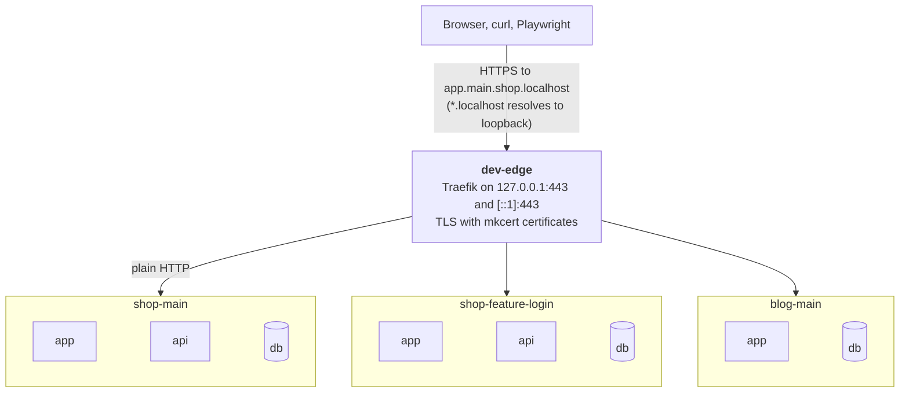
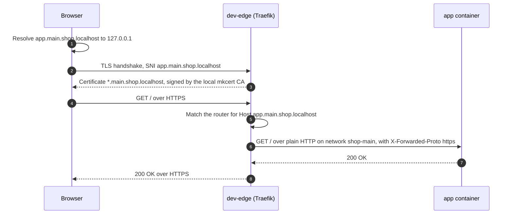

# How dev-edge works

dev-edge is one [Traefik](https://doc.traefik.io/traefik/) container, named `dev-edge`, that owns
the HTTP and HTTPS ports for the whole machine and routes requests by host name to containers of
any project. The `dev-edge` CLI is a thin Bash wrapper that starts it, issues certificates and
connects it to project networks.



Each box is one project's own Docker network. The edge is attached to all of them; the projects
cannot reach each other.

## A request, step by step



The sections below explain each step.

## 1. Name resolution: `*.localhost`

[RFC 6761](https://www.rfc-editor.org/rfc/rfc6761#section-6.3) reserves `localhost` and every name
under it for the local machine. Chrome, Edge, Firefox and Safari resolve `anything.localhost` to
127.0.0.1 / ::1 on every platform. Current macOS and Linux with systemd-resolved or
`nss-myhostname` do the same system-wide, so curl, Node, Python and Go work too.

There is no DNS server and no hosts file to maintain, and the names can never leak to or be
answered by a real DNS server.

## 2. Trust: mkcert

`dev-edge init` runs `mkcert -install` once. mkcert creates a local certificate authority and adds
its public certificate to the system trust store (and to Firefox's NSS store when `certutil` from
`nss` / `libnss3-tools` is installed). Certificates it signs are trusted on this machine only.

The CA's private key stays in `$(mkcert -CAROOT)`. Whoever has it can create certificates your
machine trusts for any domain, so never copy, commit or share `rootCA-key.pem`. `mkcert -uninstall`
removes the trust again.

## 3. Certificates per project or stack

`dev-edge cert <name> <domain>...` signs a certificate, writes it to `~/.config/dev-edge/certs/`
and registers it with Traefik through a small file in `~/.config/dev-edge/dynamic/`. Traefik
watches that folder, so a new certificate is used immediately, without a restart. Traefik picks
the certificate whose names match the requested host (SNI).

Certificates are local, free and instant: no rate limits, nothing published anywhere. The command
is idempotent: it re-issues only when the list of domains changes, so project start scripts can
call it every time.

A wildcard covers exactly one label: `*.main.shop.localhost` covers `app.main.shop.localhost` but
neither `main.shop.localhost` nor `x.app.main.shop.localhost`. Pass several domains to cover more:

```bash
dev-edge cert shop-main 'main.shop.localhost' '*.main.shop.localhost'
```

## 4. Routing: Docker labels

Traefik's Docker provider reads labels from running containers. Only containers with
`traefik.enable=true` are exposed; everything else stays invisible. A router matches requests
(`Host(...)`), a service says where to send them:

```yaml
labels:
  - traefik.enable=true
  - traefik.http.routers.shop-main-app.rule=Host(`app.main.shop.localhost`)
  - traefik.http.services.shop-main-app.loadbalancer.server.port=3000
```

The edge's HTTPS entry point is the default for every router and has TLS enabled, so labels never
need entry point or TLS settings. Plain HTTP requests are redirected to HTTPS.

Router and service names are global across all projects on the machine. Two projects that both
define a router called `app` would overwrite each other, which is why every name is prefixed with
`<project>-<stack>-`.

Processes running on the host instead of in Docker are routed with a file in
`~/.config/dev-edge/dynamic/` pointing at `http://host.docker.internal:<port>`; see
[examples/host-service.yml](../examples/host-service.yml).

## 5. Isolation: attach, don't share

The usual way to put many projects behind one proxy is a shared Docker network that every project
joins. That has a nasty side effect: Docker's DNS on a shared network resolves service names
across projects, so `db` or `redis` in one project can suddenly resolve to another project's
container.

dev-edge does the opposite. Each project keeps its own network, and `dev-edge attach <network>`
connects the edge container to it. The edge can reach every project; projects cannot reach each
other. The CLI remembers attached networks in `~/.config/dev-edge/attached` and re-attaches them
when the edge is recreated (`dev-edge restart`, `dev-edge ports`).

Because Docker will not remove a network that still has a container connected,
`dev-edge detach <network>` has to run before `docker compose down`.

## 6. Stacks: many copies of one project

A stack is one running instance of a project. Everything that has to be unique derives from the
stack name:

| Thing | Pattern | Example (`STACK=feature-login`) |
|---|---|---|
| Compose project | `<project>-<stack>` | `shop-feature-login` |
| Network | `<project>-<stack>` | `shop-feature-login` |
| Host names | `<service>.<stack>.<project>.localhost` | `app.feature-login.shop.localhost` |
| Certificate | `*.<stack>.<project>.localhost` | `*.feature-login.shop.localhost` |
| Router / service names | `<project>-<stack>-<service>` | `shop-feature-login-app` |

Because no stack publishes host ports, any number of them run at once. A project that only ever
runs one copy can drop the stack label: `<service>.<project>.localhost` with a
`*.<project>.localhost` certificate.

## 7. TLS ends at the edge

Containers keep serving plain HTTP on their project network; only the edge speaks TLS. Applications
need no certificates and no CA configuration. They learn the original scheme and host from the
`X-Forwarded-Proto` and `X-Forwarded-Host` headers Traefik adds.

The exception is a container that acts as an HTTPS *client* of another local URL, for example
Playwright running inside a container and opening `https://app.main.shop.localhost`. Inside a
container `*.localhost` means the container itself, so that client needs two extras:

- a network alias on the edge for the host name, so the name resolves to the edge:
  `docker network connect --alias app.main.shop.localhost shop-main dev-edge`
  (run `dev-edge detach shop-main` first if the edge is already attached);
- trust for the CA: mount `$(mkcert -CAROOT)/rootCA.pem` (the public certificate only) and point
  the runtime at it (`NODE_EXTRA_CA_CERTS`, `SSL_CERT_FILE`, `REQUESTS_CA_BUNDLE`, or
  `update-ca-certificates` in the image).

Prefer calling the other service by its internal name over plain HTTP (`http://api:8000`) when you
can. Playwright, Cypress or curl running on the host need none of this.

## 8. Ports and the network

The edge publishes its ports on 127.0.0.1 and ::1 only, so nothing is reachable from your LAN or
Wi-Fi. Ports default to 80 and 443; `dev-edge ports <http> <https>` changes them. Inside the
container Traefik listens on the same port numbers as outside, so redirects and absolute URLs carry
the port the browser actually uses.

## What dev-edge deliberately does not do

- **No DNS server or hosts-file edits.** `*.localhost` already resolves everywhere that matters.
- **No custom TLDs** (`.test`, `.dev`). They need a resolver, and `.dev` is a real TLD with HSTS
  preloading.
- **No per-project configuration in dev-edge itself.** Projects describe their routes with labels;
  dev-edge only owns ports, certificates and network attachments.
- **No production use.** The dashboard is unauthenticated and the CA is trusted for any name.
